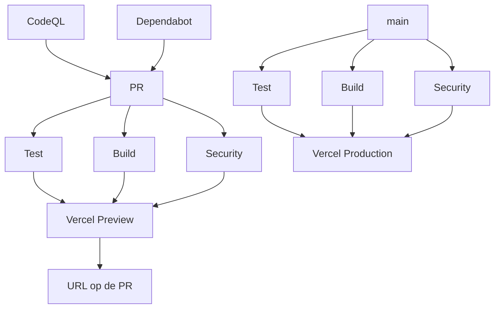

# TransportMe

Planning, ritten en facturen voor ziekenhuisvervoer in België. De app is bedoeld voor de **beheerder**: je ziet alle chauffeurs samen, plant ritten, volgt de dagkaart en maakt facturen en een rittenlijst.

Werkt op **telefoon en computer**. Licht/donker volgt de instelling van je toestel.

## Starten

```bash
npm install
npm run dev
```

Open in de browser: `http://localhost:5173`.

Productiebuild: `npm run build` → map `dist/`.

## Vijf schermen

Onderaan op de telefoon (bovenaan links op groot scherm):

1. **Overzicht** — dagkaart per chauffeur, ritten onderweg, deze week, en ritten die nog afgewerkt moeten worden.
2. **Planning** — alle ritten, gegroepeerd per dag. Zoeken, filteren, starten, voltooien en aanpassen.
3. **Chauffeurs** — status en cijfers van de maand per chauffeur.
4. **Financieel** — omzet, kosten en netto van het team of van één chauffeur. Factuur (PDF), rittenlijst (Excel) en kosten.
5. **Instellingen** — prijslijst aanvullen of corrigeren, factuurgegevens en logo, back-up, bonnen inlezen, tarieven.

**Nieuwe rit** staat als knop boven de navigatie (telefoon) of onderaan de linkerbalk (computer).

Op groot scherm (vanaf 1024px) staat de navigatie links (232px). De inhoud is max. 1160px breed.

## Rittenlijst (Excel)

In **Financieel → Ritten en factuur** en in het teamoverzicht:

- **Rittenlijst downloaden (Excel)** — één blad *Rittenregistratie* (of één blad per chauffeur voor het team), in hetzelfde formaat als het klantsjabloon.
- **Rittenlijst inlezen (Excel)** — in Planning of bij de factuur: dezelfde klantbestanden (zoals `Ritten_maand_augustus.xlsx`) vullen automatisch de voltooide ritten in.
- **Factuur downloaden (PDF)**
- **CSV voor boekhouder**

De Excel heeft parameters bovenaan (prijs per schijf, opstart, nacht, btw), één regel per bonnummer, en formules voor totaal excl. btw, btw en totaal incl. btw.

## Vergoeding

- **€15** per rit (opstart)
- **€25** per begonnen 20 km
- Nachtrit (20:00–05:00): +30% op het aantal schijven
- Forfait Sango / RKV Mechelen ↔ UZA Edegem: **€35**, zonder nachttoeslag

Voorbeeld: 45 km overdag = €15 + 3×€25 = **€90**. ’s Nachts wordt dat **€115**.

## Omgeving (Vercel)

De repo is publiek. Zet geheimen alleen in Vercel en in lokale `.env` (niet in git, nooit `VITE_` voor toegang).

| Variabele | Verplicht | Waar |
| --- | --- | --- |
| `SESSION_SECRET` | ja | Vercel Production + Preview + Development |
| `AUTH_PIN_SALT` | ja | idem |
| `AUTH_PIN_HASH` | ja | idem |
| `AUTH_PEPPER` | ja | idem |
| `BLOB_READ_WRITE_TOKEN` | ja, voor dezelfde ritten op telefoon en computer | Vercel → Storage → Blob, store aan dit project koppelen |
| `VITE_GOOGLE_MAPS_API_KEY` | nee | alleen als je Google Maps wilt; sleutel is zichtbaar in JS, beperk op HTTP-referrer |
| `VITE_OPENROUTE_API_KEY` | nee | extra routedienst |
| `VITE_MAPLIBRE_STYLE_URL` | nee | eigen kaartstijl |

1. Lokaal: `printf '%s' 'jouw-code' | node scripts/hash-pin.mjs`
2. Plak de vier `AUTH_*` / `SESSION_SECRET`-regels in `.env` en in Vercel. Geen aanhalingstekens.
3. Blob-store koppelen (token niet handmatig in git).
4. **Redeploy**. Nieuwe variabelen gelden pas na een nieuwe publicatie.
5. Preview: Vercel Deployment Protection uitzetten, anders blokkeert Vercel de login vóór de app. Production-URL (`transport-tawny-xi.vercel.app`) heeft `/api/login` pas na publicatie van deze branch naar Production.

Zonder de vier toegangsheimen weigert de **server** de login. De app opent dan nog wel de **lokale kluis** op dat toestel. Er is geen publieke registratie.

## GitHub Secrets (verplicht)

Zonder deze drie stopt de pipeline op Preview én Production (`exit 1`).  
GitHub → **Settings → Secrets and variables → Actions → New repository secret**.

| Secret | Waar vandaan |
| --- | --- |
| `VERCEL_TOKEN` | [Vercel → Account Settings → Tokens](https://vercel.com/account/tokens). Scope: de team van dit project. |
| `VERCEL_ORG_ID` | Vercel → Project → Settings → General → **Team ID** (`team_…`) |
| `VERCEL_PROJECT_ID` | zelfde pagina → **Project ID** (`prj_…`) |

**Niet** in GitHub zetten: `AUTH_*`, `SESSION_SECRET`, `BLOB_READ_WRITE_TOKEN`, de toegangscode. Die blijven in Vercel Environment Variables.

Daarna GitHub → **Settings → Environments**:

1. `preview` — geen extra bescherming nodig.
2. `production` — Required reviewers aanzetten, zodat `main` niet zonder goedkeuring live gaat.

Automatische Vercel-deploys vanaf Git staan **uit** (`vercel.json` → `git.deploymentEnabled: false`). Alleen deze pipeline publiceert.

## CI/CD

Eén workflow: `.github/workflows/pipeline.yml`.



- **Test / Build / Security** (elke PR en elke push naar `main`): `npm test`, productiebuild, geen hashes/tokens in git of in `dist/`, Gitleaks, `npm audit --omit=dev --audit-level=high`.
- **Preview** (PR, na groene gate): `scripts/vercel-deploy.sh preview`. Zonder de drie GitHub Secrets faalt de job. Login gebruikt Vercel Preview-env (`AUTH_*`, Blob). Dependabot- en fork-PR’s skippen Preview.
- **Production** (alleen `main`, na groene gate + environment `production`): `scripts/vercel-deploy.sh production`.
- **CodeQL** op PR, `main` en maandag. **Dependabot** wekelijks als PR, nooit direct op main.
- Lokaal dezelfde gate: `npm run ci`. Handmatig: `npm run deploy:preview` / `npm run deploy:production` (zelfde drie variabelen in je shell).

Uitbreiden: extra job in `pipeline.yml` (lint, e2e), required status checks op `main` (Test, Build, Security, Production).

## Gegevens

Na het openen deelt de app de **versleutelde kluis** met je andere toestel (ritten, planning, factuurgegevens). De server bewaart ciphertext, niet de toegangscode. Originele bonfoto’s blijven op het toestel dat ze inlas.

Lokaal staat de kluis in `server/data/` (gitignored). Op Vercel de Blob-store aan het project koppelen (Production én Preview), daarna Redeploy. Zonder die token blijven de ritten alleen op het toestel.

Na een geslaagde login worden bestaande localStorage- en IndexedDB-gegevens versleuteld (AES-GCM; sleutel in geheugen, afgeleid van de toegangscode; naast de data staat alleen een zout).

**Wat dit wel doet:** iemand met alleen de bestanden op schijf ziet na migratie geen leesbare ritten of originele bonnen.

**Wat dit niet doet:** een login beschermt bestaande plaintext pas ná migratie; XSS in de open sessie kan de geheugensleutel nog gebruiken; de toegangscode gaat bij login naar de server (geen zero-knowledge); back-ups bevatten ciphertext plus kluismeta — zonder code niet leesbaar, mét code wel.

Originele bonnen worden na de ingestelde bewaartermijn (standaard 62 dagen, Instellingen) verwijderd.

De vaste ritten komen uit de **prijslijst van 26 mei**. Ontbreekt een rit of klopt een km niet, dan pas je dat aan onder Instellingen → Prijslijst aanvullen. Jouw wijziging gaat voor op de prijslijst.

## Kaart en afstand

De kaart toont vertrek en bestemming. Afstanden worden over de weg gemeten. Zonder extra instelling werkt de gratis routedienst; met een Google-sleutel kan de app Google Maps gebruiken.

**Ziekenhuizen zoeken** werkt via OpenStreetMap (Nominatim).

Lijst van Vlaamse ziekenhuizen vernieuwen:

```bash
npm run data:ziekenhuizen
```
